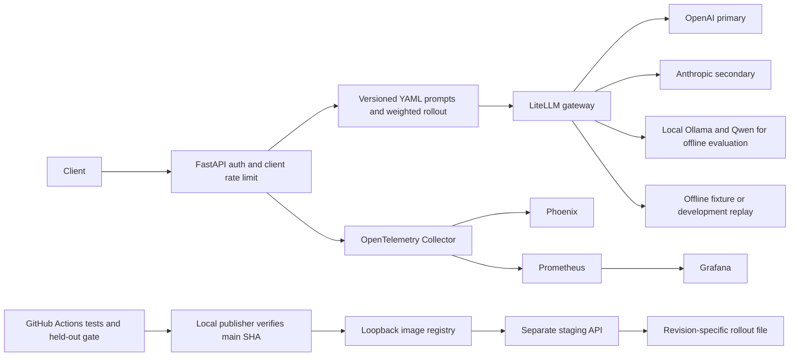
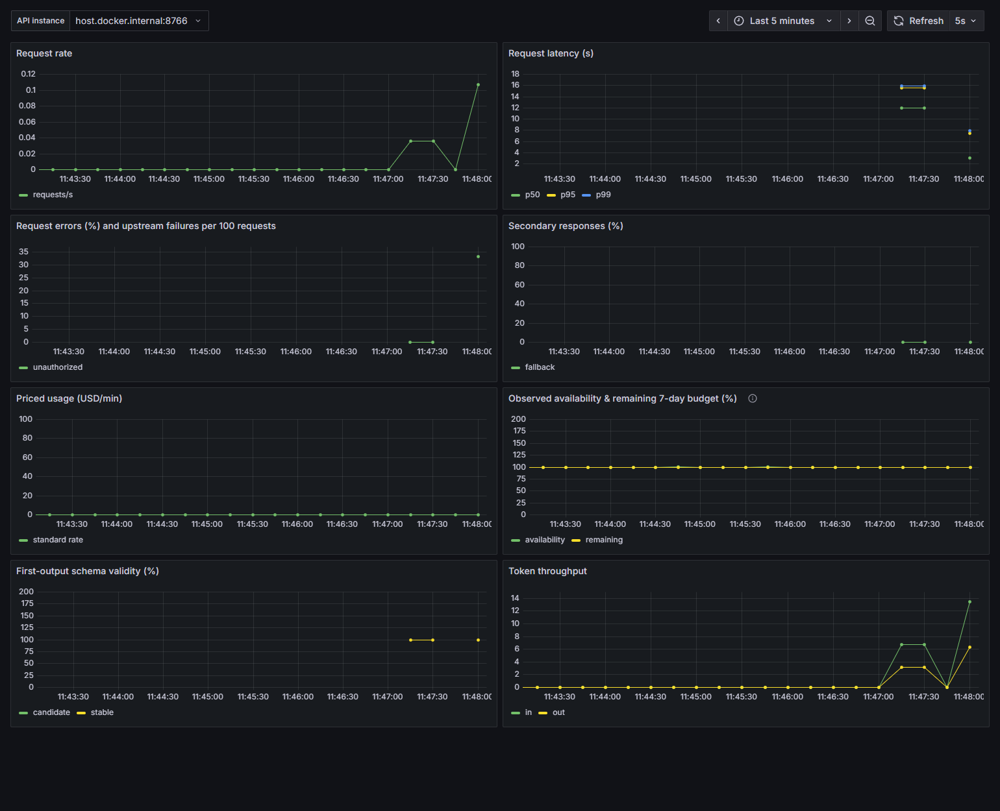

# LLMops Support Ticket Triage

## What problem does it solve?

When support tickets arrive together, an agent has to decide which issue needs attention first and how to respond. This service reads the customer's message and suggests a category, priority, product, summary and draft reply. The agent reviews the draft before sending it.

### How we operate the service

- **Check a release with GitHub Actions.** Each pull request runs tests and compares the candidate with the stable version. One candidate classified more tickets correctly, but its p95 response time rose from 2.64 to 3.17 seconds. The gate blocked that release. [Release comparison](results/local/v4-gate.md)
- **Monitor traffic with Prometheus and Grafana.** Prometheus collects request counts, latency, errors and fallback metrics. The Grafana dashboard shows how they change during load tests. We tested alerts for rapid error-budget consumption and cost spikes. [Dashboard under load](results/local/grafana-load.png)
- **Investigate one ticket with Phoenix.** A trace links the API request to its model calls. In a controlled failover drill, the trace showed two failed primary attempts followed by a successful secondary response. [Recorded trace](results/fixture/phoenix-trace.json)

[System design](#architecture) · [Example output](#example-output) · [Run locally](#run-locally) · [Measured results](#measured-results)

## A 60-second tour

1. [Read a real ticket response](#example-output). Look at the suggested priority and the reply an agent would review.
2. [Preview the failover recording](results/fixture/failover-demo.webm). The full video takes about two minutes and shows the controlled drill.
3. [Open the dashboard snapshot](results/local/grafana-load.png). Compare the incoming request rate with the time the service took to respond.

### Operations evidence

| Question | Evidence |
| --- | --- |
| Did the release checks run? | [Successful GitHub Actions run](https://github.com/saicharanreddyamedapu/LLMops-Support-Ticket-Triage/actions/runs/45477392932) |
| Which provider attempt answered? | [Phoenix trace export with the retry and fallback spans](results/fixture/phoenix-trace.json) |
| What happened across requests? | [Grafana dashboard under Qwen load](results/local/grafana-load.png) |

## Architecture

FastAPI accepts tickets and Pydantic validates their fields. Versioned YAML keeps prompt changes reviewable. LiteLLM routes calls and Ollama runs Qwen locally. Docker Compose starts the API and monitoring services together. OpenTelemetry sends request traces to Phoenix so you can inspect one ticket. Prometheus stores time-series metrics that Grafana plots across tickets. k6 generates traffic for capacity tests, and GitHub Actions compares release candidates against the stable baseline.



### How a ticket moves through the system

1. FastAPI authenticates the caller and validates the ticket text.
2. The rollout configuration selects a versioned prompt. The gateway calls the configured model and validates its structured response.
3. The client receives the triage fields and a trace ID. Phoenix shows individual model attempts. Grafana graphs traffic, latency and errors across requests.

### Project structure

| Directory | What to look for |
| --- | --- |
| `app/` | API routes, model calls, validation and telemetry |
| `prompts/` and `config/` | Prompt versions, model settings and rollout rules |
| `ops/` | Collector, alert rules, dashboards and load driver |
| `scripts/` and `tests/` | Evaluation, release checks and rollback drills |
| `results/` | Recorded responses, measurements and screenshots |

## Example output

For an account-closure question, local Qwen produced these five fields. The API also returns the serving model and prompt version. [Recorded responses](results/local/v1-outputs.json)

```json
{
  "category": "ACCOUNT",
  "priority": "normal",
  "product": "membership",
  "summary": "The customer is asking how to close their account.",
  "draft_reply": "Hello, I can certainly help you with closing your account. Please confirm which specific account category you are referring to so I can guide you through the correct steps."
}
```

## Run locally

To follow one ticket from submission to monitoring on your own computer:

1. Install [Docker Desktop](https://docs.docker.com/desktop/) for your operating system, open it and wait for the engine to start. Use Linux containers on Windows. In a terminal check that `docker info` shows a Server section and `docker compose version` prints a version.
2. With access to this private repository, use **Code → HTTPS**, clone the repository with Git, and open a terminal in the folder containing `compose.yaml`. Set the Git revision as described below before starting Compose.
3. Start the demo with the command below. Run `docker compose ps` to check the services and confirm that the API is healthy.

```shell
docker compose up --build -d --wait
```

`make demo` embeds the checkout revision automatically. When using Compose directly, first set `$env:GIT_SHA = git rev-parse HEAD` in PowerShell or `export GIT_SHA=$(git rev-parse HEAD)` in a POSIX shell. Without it a container reports `unavailable`. Fixture defaults require no sign-up or paid key.

```powershell
Invoke-RestMethod http://127.0.0.1:8765/triage -Method Post -ContentType 'application/json' -Headers @{Authorization='Bearer fixture-demo'} -Body '{"text":"How can I track my order?"}'
```

The five output fields are category, priority, product, summary and draft_reply. The response also identifies the prompt version, actual model, Git revision, cohort, first-pass schema result and fallback. Explore the [interactive API](http://127.0.0.1:8765/docs), [Grafana](http://127.0.0.1:13000/d/triage), [Phoenix](http://127.0.0.1:16006) and [Prometheus](http://127.0.0.1:19090). Run `docker compose stop` to stop this stack.

4. To send the example from a browser, open the interactive API, click **Authorize**, enter `fixture-demo`, and close the dialog. Open **POST /triage → Try it out**, enter `{"text":"How can I track my order?"}` and click **Execute**. Read the draft in **Response body** and copy **x-trace-id** from **Response headers**.
5. In **Docker Desktop → Containers**, expand **ticket-triage**. Click the **16006** port beside **phoenix**. Under **Projects**, open the project receiving the requests and select **Traces**. Open the request around the time you clicked Execute and match its trace ID. Select the child model call to see its timing.
6. Return to Docker Desktop and click the **13000** port beside **grafana**. Open **Dashboards → LLMops Support Ticket Triage**, select the API instance for the demo and a time range containing your request. Send a few tickets and allow time for the metrics scrape. Start with **Request rate** and **Request latency**. The local dashboard allows anonymous viewing.

### Serve real responses with Qwen

Run Ollama on the host with the `qwen3.5:9b` weights pinned in [the local registry](prompts/local.yaml). Install Python 3.12 and uv, run `ollama pull qwen3.5:9b`, then run `uv sync --frozen` and `uv run --frozen python -m scripts.prepare_tokenizers` from the repository root. Next, start the host API in a PowerShell window. Use the same local key in the request header. This instance uses port 8766 so it can run beside the fixture demo.

```powershell
$env:TRIAGE_MODE = 'local'
$env:TRIAGE_KEYS = 'local-demo-only'
$env:RECORD_REPLAY = '1'
$env:AUTO_ROLLBACK = '1'
$env:OTEL_EXPORTER_OTLP_TRACES_ENDPOINT = 'http://127.0.0.1:14318/v1/traces'
uv run --frozen uvicorn app.main:app --host 127.0.0.1 --port 8766
```

Open [local readiness](http://127.0.0.1:8766/readyz) to verify the model digest. Send the same request shown above to port 8766 with `Bearer local-demo-only`. Local inference and reply grading use loopback and incur zero provider fees. Hardware and electricity are outside that figure.

The host service exports traces to the Compose Collector on 14318. On Docker Desktop, set `$env:TRIAGE_METRICS_TARGET = 'host.docker.internal:8766'` and run `docker compose up -d collector` to graph the host service. The default scrape target is the Compose fixture. The 150 ms dashboard reference line comes from the fixture baseline.

## Measured results

**Local Qwen, 132 held-out tickets, $0 in provider fees.** The v4 candidate improved exact category accuracy from **58/132 to 125/132** and product from **119/132 to 130/132**. Both versions produced 132 valid responses on the first attempt. The release gate blocked v4 because p95 rose from **2.64 s to 3.17 s**, above the **3.04 s** cutoff. That first trial kept v4 at zero weight. In a fresh run under the 4.00 s local Qwen p95 limit, v4 reached 3.03 s and classified 125/132 tickets correctly. The local demo now routes 100% of tickets to v4, with v1 available for rollback. [Runtime routing rules](#release-and-rollback). [Current gate](results/local/gate.md). [Real-model comparison](results/local/v4-gate.md)

In the isolated canary drill, v2 passed a fresh fixture gate, then reached **242.3 ms p95** across 25 requests versus **53.3 ms** across 228 requests on v1. Setting its weight to zero restored v1 on **30/30** subsequent requests at **53.0 ms p95**. The drill injected 180 ms into candidate calls. [Measured rollback](results/fixture/canary-recheck.json) · [Earlier Compose drill](results/fixture/canary.json)



**Actual API spend was $0.** All 132 held-out Bitext tickets succeeded using simulated model responses. At the documented provider rates, the shorter prompt cost an estimated **$0.000144 per ticket**, or **14.4¢ per 1,000 successful tickets**, down from **16.4¢** with the baseline prompt. The project’s estimated cost target is **under $0.22 per 1,000 successful tickets**. [Evaluation results](results/fixture/current.json)

## Evaluation and cost

<details>
<summary>Commands, measurements and interpretation</summary>

Use Python 3.12 and uv. Run these from the repository root. On Windows use `python -m uv` in place of `uv` if installed through pip.

```shell
uv sync --frozen
uv run --frozen python -m scripts.prepare_tokenizers
uv run --frozen python -m pytest -q
uv run --frozen python -m scripts.evaluate --version v1 --output .local/base.json
uv run --frozen python -m scripts.evaluate --version v2 --output .local/candidate.json
uv run --frozen python -m scripts.gate .local/base.json .local/candidate.json
```

`make eval` runs the stable prompt against local Qwen on all 132 held-out tickets, grades the replies, prints the baseline table and writes `.local/eval/baseline.json` and `.local/eval/stable-outputs.json`. The accepted baseline is versioned at [results/baseline.json](results/baseline.json). Each result includes the data digest, run mode, timestamp, model, prompt and source revision. `make eval-fixture` runs the deterministic candidate benchmark. [Fixture baseline](results/fixture/baseline.json) · [Fixture candidate](results/fixture/current.json)

`make eval-local` runs the baseline followed by the configured candidate on the same tickets and applies the regression thresholds. Each role has its own output file, including when both roles serve v1. On Windows without Make, run the `eval` command followed by the two commands under `eval-local` in the [Makefile](Makefile). End-to-end latency covers the triage API response, retries and repairs. The same model grades each reply against the Bitext reference afterward. Those grades still need independent calibration.

Python setup downloads checksum-verified token tables once. Docker includes them in the image. The adapter integration test sends an OpenAI-format request to a local server returning HTTP 429, then verifies the Anthropic-format request and successful response. This exercises the SDK adapters without provider accounts or charges.

The fixture classifies by keyword. Its scores can reveal changes to the harness, schema or service, but it does not evaluate whether a real model follows a rewritten prompt. The live quality gate requires at least 200 human priority reviews, held-out priority labels, reply grades for every successful case and complete reported inference usage. Those checks remain open.

The frozen sample contains 132 dev and 132 held-out tickets across 11 categories. Category uses exact match to the upstream label. Product uses exact match to the project-defined category-to-product mapping. Priority is reported against either the human review file or the explicitly selected provisional assistant labels. The held-out provisional set contains 68 normal and 64 low-priority tickets, so its score measures only those two classes. Summary uses a lexical grounding proxy: at least half of its distinct word tokens must appear in the ticket. The fixture often echoes the ticket, so 100% on this check offers little evidence of summary quality. Only draft_reply receives an optional model grade. [Data provenance and priority rubric](data/README.md)

The unconstrained local adapter returned only 9 valid responses on 132 tickets. One response combined several category names into a single string. Passing the API schema to Ollama fixed that failure mode. The two early constrained versions still gave weak category accuracy. On the first two frozen development examples per category, v2 got 8/22 categories correct. Writing out the intent definitions in v3 brought that to 22/22, while only 14 products matched. Version v4 applies the catalog to the model's predicted category and achieved 22/22 on both fields on the same development screen. Its product score consequently depends on its category prediction. The earlier v3 held-out run spanned an interruption, including three deadlines and one missing grade. The gate rejected it. [Diagnostic run](results/local/unconstrained-v1.json) · [Development screen](results/local/dev-v4.json) · [Incomplete v3 run](results/local/v3.json)

|Local Qwen, same 132 test tickets|v1 baseline|v2 trimmed|v4 catalog|
|---|---:|---:|---:|
|Category exact match|43.9%|34.8%|94.7%|
|Product exact match|90.2%|81.8%|98.5%|
|Provisional priority agreement|54.5%|56.1%|59.1%|
|Draft replies passing the uncalibrated Qwen judge|77.3%|77.3%|82.6%|
|First-pass schema / successful requests|132 / 132|132 / 132|132 / 132|
|Warmed serial p50 / p95 / p99 (seconds)|2.27 / 2.64 / 2.87|2.10 / 2.45 / 2.89|2.51 / 3.17 / 3.43|
|Reported triage input / output tokens|25,053 / 11,957|18,453 / 11,104|29,409 / 12,726|
|Actual provider fees|$0|$0|$0|
|Original release decision|Stable|Blocked on category and product|Blocked under the original latency limit|

The comparison uses an RTX 5050 Laptop GPU, the pinned Qwen weights and the same frozen test IDs. Triage latency excludes the subsequent judge call. The JSON records judge tokens separately. Priority scores have no independent human validation. These historical results used the release thresholds in effect at the time. [Original v1 measurement](results/local/original-v1/baseline.json) · [Trimmed version](results/local/v2.json) · [v4 experiment](results/local/v4.json) · [v4 ticket outputs](results/local/v4-outputs.json)

|Held-out fixture measure, same 132 tickets|v1 baseline|v2 trimmed|
|---|---:|---:|
|Category / product exact match|60.6% / 71.2%|60.6% / 71.2%|
|First-attempt schema / valid response|132/132 / 132/132|132/132 / 132/132|
|p50 / p95, warmed serial in-process HTTP|46.5 / 48.6 ms|46.8 / 49.1 ms|
|Estimated input / output tokens|24,789 / 7,309|18,189 / 7,309|
|Estimated USD per request|0.00016371|0.00014371|
|Estimated USD per 1,000 successes|0.16371|0.14371|
|Projected USD at 100,000 requests/month|16.37|14.37|
|Paid provider spend|$0|$0|
|Reviewed priority / live reply-judge samples|0 / 0|0 / 0|

At the v2 fixture rate and 100,000 requests per month, a self-hosted installation would have to deliver equivalent quality and capacity for less than $14.37 per month to beat the modeled API bill. For another volume, divide monthly fixed hosting cost by the difference between API and self-hosted variable cost per successful request. The laptop experiment measures throughput and provider fees. A measured break-even volume also needs power, hardware and operating costs.

The shorter system prompt removed 50 estimated input tokens per request and reduced modeled unit cost by 12.2%. With v2, output accounted for about 62% of estimated cost. Fixture counts use a bundled tokenizer and message framing. Live mode uses provider-reported usage for every returned attempt, including repairs. List-price estimates use standard uncached text rates. Unconfirmed live attempts retain their budget reservations and are counted separately. [Dated prices and official sources](config/prices.json)

The local development example records each Qwen response to disk. With the same state directory and rollout, restart in `TRIAGE_MODE=replay` with `REPLAY_SOURCE=local` to serve those responses. For a hosted development recording, use `RECORD_REPLAY=1` and replay with the default `REPLAY_SOURCE=live`. Keys include the model, prompt configuration and messages. The cache stores model output and needs the same protection as the original ticket. Quality and latency benchmarks bypass recording and replay. The default application budget is zero.

</details>

## Load and SLOs

<details>
<summary>Commands, measurements and interpretation</summary>

Select an API instance in Grafana to inspect its traffic and error budget. The Qwen and fixture instances have independent burn-rate and cost alerts. At 11:45 IST on 24 November 2026, Prometheus had Qwen samples in **16 of 10,080 minutes** and fixture samples in **81**. Both showed 100% success among observed eligible requests. The seven-day verdict for both was **incomplete**. Run `python -m scripts.slo_report --mode local` to refresh the Qwen report. [Qwen coverage](results/local/slo-window.json) · [Fixture coverage](results/fixture/slo-window.json)

The same k6 script also exercised the stable v1 **real Qwen API** on Docker Desktop. Each 16-second stage repeatedly submitted an order-tracking ticket to the authenticated host API. Completed throughput includes time spent draining in-flight requests after each stage. These short runs characterize one laptop and one ticket shape.

|Offered RPS|Completed requests|Completed RPS including drain|p50 / p95 / p99 (s)|HTTP errors / dropped arrivals|
|---:|---:|---:|---:|---:|
|0.25|4|0.25|2.09 / 2.21 / 2.22|0 / 0|
|0.50|9|0.48|3.33 / 5.18 / 5.72|0 / 0|
|1.00|17|0.53|8.99 / 15.18 / 15.74|0 / 0|

At one offered request per second, queueing coincided with a sevenfold increase in p95 over the 0.25 RPS stage. All 30 requests succeeded. The client limiter was configured at 12 RPS, well above these rates. [0.25 RPS](results/local/load-0.25.json) · [0.50 RPS](results/local/load-0.5.json) · [1 RPS](results/local/load-1.json)

In a separate HTTP check, stable v1 matched 7/8 assistant-authored priority probes. It assigned high priority to a report of ongoing unauthorized card charges, for which the rubric specifies urgent. The held-out test set has no urgent examples. Phoenix captured the final probe and its successful Qwen child with 190 input and 94 output tokens. [Priority probes](results/local/priority-smoke.json) · [Real-model trace](results/local/phoenix-trace.json)

`uv run --frozen python -m scripts.load` runs k6 against the local fixture Compose API with one client identity. Four 15-second constant-arrival-rate stages used a 12 requests/s sliding-window limit. Throughput divides completed requests by the scheduled window. Counts can include an iteration started at the window boundary.

|Target RPS|Completed / achieved RPS|All-request p50 / p95 / p99 (ms)|HTTP 429|Other errors|
|---:|---:|---:|---:|---:|
|2|31 / 2.07|36.8 / 39.3 / 39.4|0|0|
|6|90 / 6.00|38.1 / 40.2 / 41.5|0|0|
|12|181 / 12.07|36.9 / 39.8 / 41.9|13|0|
|24|361 / 24.07|7.0 / 41.0 / 48.7|181|0|

Rate limiting first appeared at the configured boundary of 12 RPS. At 24 RPS, fast 429s lowered the median while successful-request p95 reached 41.9 ms. This sweep measures admission limits and service latency with a fixture backend. [2 RPS](results/fixture/load-2.json) · [6 RPS](results/fixture/load-6.json) · [12 RPS](results/fixture/load-12.json) · [24 RPS](results/fixture/load-24.json)

Provisional fixture targets are 99% eligible-request availability over seven days and p95 under 150 ms over five minutes at roughly 5 RPS. The latency ceiling is about three times the warmed v1 p95. The availability target allows one failure per 100 eligible requests against a baseline of 132/132 successes. The list-price objective is under $0.22 per 1,000 successes with a $0.065/min spike alert at the design rate. A full seven-day window and live targets remain unverified. Responses are non-streaming, so TTFT is inapplicable.

GenAI span attributes follow [OpenTelemetry semantic conventions v1.37.0](https://github.com/open-telemetry/semantic-conventions/tree/v1.37.0/docs/gen-ai). Request and child spans carry sanitized metadata only. [Dashboard JSON](ops/grafana/triage.json) · [Alert rules](ops/alerts.yaml) · [Failover trace](results/fixture/failover-trace.json)

</details>

## Release and rollback

The local Qwen release check measures p95 across the held-out tickets and accepts up to **4 seconds**. Once the app is running, it uses a separate **5-second** threshold for individual responses.

- **Normal operation.** All new tickets go to v4. Check the effective traffic percentage at [local rollout status](http://127.0.0.1:8766/rollout/status).
- **Repeated slow responses.** If at least two of the last 20 successful v4 responses took over five seconds, the app sends a synthetic order-tracking ticket to v1. A valid v1 response within five seconds sends subsequent traffic to v1. If the probe fails or times out, v4 keeps serving. The original customer ticket is never replayed by the probe.
- **Server error.** A v4 HTTP 5xx routes subsequent tickets to v1 immediately. The rollback persists across restarts. [Operator runbook](RUNBOOK.md#local-automatic-rollback)

<details>
<summary>Commands, measurements and interpretation</summary>

On PRs, the workflow runs unit tests on the candidate and measures both main's stable version and the candidate on the same runner, full held-out split and fixture mode. The fixture gate rejects accuracy drops greater than 2 percentage points or p95/unit-cost increases above 15%. For local Qwen the p95 limit is 4.00 s. Missing human priority and live evidence appear in the summary. The [rejection table](results/fixture/rejection.md) shows a measured 60.6% to 9.1% category regression. The local rollout compares stable v1 with candidate v4. Public pull requests run on ephemeral GitHub-hosted Ubuntu runners. Remote artifact uploads and external staging are opt-in. [Workflow](.github/workflows/verify.yml)

The workflow also checks the recorded Qwen runs. It verifies the measured Git revisions, checks for changes to the listed inference inputs and recalculates category, product, provisional priority, schema validity, availability and reply scores from the saved ticket outputs. Inference runs on the local GPU. The CI verification needs neither model weights nor provider credentials. Reproduce that check with `python -m scripts.recorded_gate . .`.

The fixture drill starts a private loopback API with temporary rollout and fault files. It gates v1 against v2, sends 10% of traffic to v2, injects a slowdown, measures both cohorts and verifies recovery after setting candidate weight to zero.

```shell
uv run --frozen python -m scripts.drill
```

The command saves the gate, cohort measurements, trigger and recovery to `.local/canary.json`. GitHub CI repeats this drill after the release comparisons pass. [Canary thresholds](config/canary.json) · [Isolated rerun](results/fixture/canary-recheck.json) · [Two-minute fixture failover demo](results/fixture/failover-demo.webm)

</details>

## Operations and evidence

- [Verification by component](REFERENCE_REVIEW.md)
- [GitHub release check that blocked a slower candidate](https://github.com/saicharanreddyamedapu/LLMops-Support-Ticket-Triage/actions/runs/45344100922/job/138274387211)
- [Runbook and rollback procedure](RUNBOOK.md)
- [Incident report on duplicate trace spans](postmortems/001-duplicate-request-spans.md)
- [Recorded failover demo](results/fixture/failover-demo.webm)
- [Bitext dataset attribution and license](data/README.md)

## Possible next improvements

- Test a revised candidate prompt on the development split to improve category and product classification, then compare it with stable on held-out tickets.
- Investigate the slowest successful Qwen requests in Phoenix and repeat the same load test to measure any change in p95 latency.
