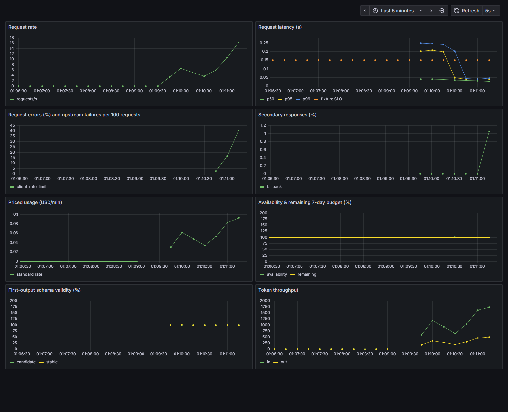
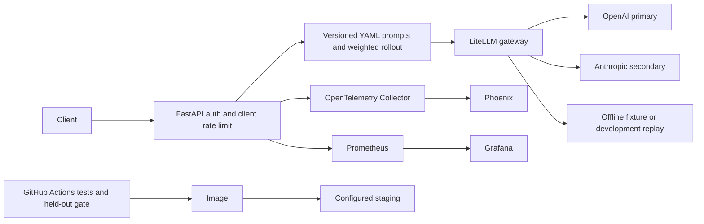

# Support ticket triage API

A FastAPI service that classifies support tickets, drafts replies and records which prompt and model served each request.

In a local rollback drill, the candidate passed a fresh held-out gate, then reached **227.3 ms p95** across 25 fixture requests versus **46.9 ms** across 185 stable requests. Setting its weight to zero restored the stable version on **30/30** subsequent requests, at **47.3 ms p95**. The test injected 180 ms into candidate calls and sent traffic through the Compose API. [Drill results](results/fixture/canary.json)



**Actual API spend was $0.** All 132 held-out Bitext tickets succeeded using simulated model responses. At the documented provider rates, the shorter prompt cost an estimated **$0.000144 per ticket**, or **14.4¢ per 1,000 successful tickets**, down from **16.4¢** with the baseline prompt. The project’s estimated cost target is **under $0.22 per 1,000 successful tickets**. [Evaluation results](results/fixture/current.json)

## Run locally

Install Docker with Compose. From this folder:

```shell
docker compose up --build -d --wait
```

This is also the Windows PowerShell equivalent of `make demo`. To embed the revision in Docker responses, first set `$env:GIT_SHA = git rev-parse HEAD` in PowerShell or `export GIT_SHA=$(git rev-parse HEAD)` in a POSIX shell. Without it a container reports `unavailable`. Fixture defaults require no sign-up or paid key.

```powershell
Invoke-RestMethod http://127.0.0.1:8765/triage -Method Post -ContentType 'application/json' -Headers @{Authorization='Bearer fixture-demo'} -Body '{"text":"How can I track my order?"}'
```

The five output fields are category, priority, product, summary and draft_reply. The response also identifies the prompt version, actual model, Git revision, cohort, first-pass schema result and fallback. Explore the [interactive API](http://127.0.0.1:8765/docs), [Grafana](http://127.0.0.1:13000/d/triage), [Phoenix](http://127.0.0.1:16006) and [Prometheus](http://127.0.0.1:19090). Run `docker compose stop` to stop this stack.

## Architecture



All provider attempts have a 3 s timeout within a 9 s request deadline. The gateway retries rate limits, upstream 5xx and timeouts with jitter, honors Retry-After and moves to the secondary when waiting would exhaust the retry allowance. It sends 400-class bad requests back as typed upstream failures. An invalid model output gets one repair. Provider authentication failures can fail over without retrying that credential. The breaker allows a recovery probe after cooldown. The input limit uses conservatively bounded UTF-8 bytes plus framing. Output is capped by the prompt registry.

## Evaluation and cost

Use Python 3.12 and uv. Run these from the repository root. On Windows use `python -m uv` in place of `uv` if installed through pip.

```shell
uv sync --frozen
uv run --frozen python -m scripts.prepare_tokenizers
uv run --frozen python -m pytest -q
uv run --frozen python -m scripts.evaluate --version v1 --output .local/base.json
uv run --frozen python -m scripts.evaluate --version v2 --output .local/candidate.json
uv run --frozen python -m scripts.gate .local/base.json .local/candidate.json
```

`make eval` runs the full held-out fixture evaluation. Each result includes the data digest, run mode, timestamp, model, prompt and source revision. The [baseline](results/baseline.json), [candidate](results/fixture/current.json) and [per-ticket outputs](results/fixture/outputs.json) are included.

Python setup downloads checksum-verified token tables once. Docker includes them in the image. The adapter integration test sends an OpenAI-format request to a local server returning HTTP 429, then verifies the Anthropic-format request and successful response. This exercises the SDK adapters without provider accounts or charges.

The fixture classifies by keyword. Its scores can reveal changes to the harness, schema or service, but it does not evaluate whether a real model follows a rewritten prompt. The live quality gate requires at least 200 human priority reviews, held-out priority labels, reply grades for every successful case and complete reported inference usage. Those checks remain open.

The frozen sample contains 132 dev and 132 held-out tickets across 11 categories. Category uses exact match to the upstream label. Product uses exact match to the project-defined category-to-product mapping. Priority becomes scorable only after human review. Summary uses a lexical grounding proxy: at least half of its distinct word tokens must appear in the ticket. The fixture often echoes the ticket, so 100% on this check offers little evidence of summary quality. Only draft_reply has an optional live judge. [Data provenance and priority rubric](data/README.md)

|Held-out fixture measure, same 132 tickets|v1 baseline|v2 trimmed|
|---|---:|---:|
|Category / product exact match|60.6% / 71.2%|60.6% / 71.2%|
|First-attempt schema / valid response|132/132 / 132/132|132/132 / 132/132|
|p50 / p95, warmed serial in-process HTTP|46.5 / 48.6 ms|46.8 / 49.1 ms|
|Estimated input / output tokens|24,789 / 7,309|18,189 / 7,309|
|Estimated USD per request|0.00016371|0.00014371|
|Estimated USD per 1,000 successes|0.16371|0.14371|
|Projected USD at 100,000 requests/month|16.37|14.37|
|Paid provider spend|$0|$0|
|Reviewed priority / live reply-judge samples|0 / 0|0 / 0|

The shorter system prompt removed 50 estimated input tokens per request and reduced modeled unit cost by 12.2%. With v2, output accounted for about 62% of estimated cost. Fixture counts use a bundled tokenizer and message framing. Live mode uses provider-reported usage for every returned attempt, including repairs. List-price estimates use standard uncached text rates. Unconfirmed live attempts retain their budget reservations and are counted separately. [Dated prices and official sources](config/prices.json)

Set RECORD_REPLAY=1 only for a controlled development run. Replay uses a disk cache keyed by model, prompt configuration and messages. It stores provider output locally and requires protection like the original ticket. Live evaluation bypasses cache reads. The default application budget is zero.

## Load and SLOs

`uv run --frozen python -m scripts.load` runs k6 against the local fixture Compose API with one client identity. Four 15-second constant-arrival-rate stages used a 12 requests/s sliding-window limit. Throughput divides completed requests by the scheduled window. Counts can include an iteration started at the window boundary.

|Target RPS|Completed / achieved RPS|All-request p50 / p95 / p99 (ms)|HTTP 429|Other errors|
|---:|---:|---:|---:|---:|
|2|31 / 2.07|36.8 / 39.3 / 39.4|0|0|
|6|90 / 6.00|38.1 / 40.2 / 41.5|0|0|
|12|181 / 12.07|36.9 / 39.8 / 41.9|13|0|
|24|361 / 24.07|7.0 / 41.0 / 48.7|181|0|

Rate limiting first appeared at the configured boundary of 12 RPS. At 24 RPS, fast 429s lowered the median while successful-request p95 reached 41.9 ms. This sweep measures admission limits and service latency with a fixture backend. [2 RPS](results/fixture/load-2.json) · [6 RPS](results/fixture/load-6.json) · [12 RPS](results/fixture/load-12.json) · [24 RPS](results/fixture/load-24.json)

Provisional fixture targets are 99% eligible-request availability over seven days and p95 under 150 ms over five minutes at roughly 5 RPS. The latency ceiling is about three times the warmed v1 p95. The availability target allows one failure per 100 eligible requests against a baseline of 132/132 successes. The list-price objective is under $0.22 per 1,000 successes with a $0.065/min spike alert at the design rate. A full seven-day window and live targets remain unverified. Responses are non-streaming, so TTFT is inapplicable.

GenAI span attributes follow [OpenTelemetry semantic conventions v1.37.0](https://github.com/open-telemetry/semantic-conventions/tree/v1.37.0/docs/gen-ai). Request and child spans carry sanitized metadata only. [Dashboard JSON](ops/grafana/triage.json) · [Alert rules](ops/alerts.yaml) · [Failover trace](results/fixture/failover-trace.json)

## Release and rollback

On PRs, the workflow runs unit tests on the candidate and measures both main's stable version and the candidate on the same runner, full held-out split and fixture mode. Main's comparator rejects accuracy drops greater than 2 percentage points or p95/unit-cost increases above 15%. Missing human priority and live evidence appear in the summary. The [rejection table](results/fixture/rejection.md) shows a measured 60.6% to 9.1% category regression. A hosted failed run and staging deployment require a destination. The local project has no remote. [Workflow](.github/workflows/verify.yml)

```shell
uv run --frozen python -m scripts.rollout 10
uv run --frozen python -m scripts.drill
uv run --frozen python -m scripts.rollout 0
```

The middle command exercises a controlled candidate slowdown against the fixture stack, evaluates the cohort thresholds, and verifies the rollback using new response metadata. Run on an isolated stack without concurrent traffic. The drill restores the prior rollout setting on exit. The last command leaves the weight at zero. [Canary thresholds](config/canary.json) · [Two-minute fixture failover demo](results/fixture/failover-demo.webm)

## What broke

Native FastAPI instrumentation and the custom request span both traced the same request. The original tests confirmed a common trace ID, which missed the extra parent. The fix assigns the request span to one instrumentation layer and tests every model span's parent ID. [Incident report](postmortems/001-duplicate-request-spans.md) · [Runbook](RUNBOOK.md)

The redaction stretch goal covered email addresses and US-style telephone numbers before inference. On five positive and five negative synthetic examples, all five positives were redacted and no negative controls changed. Across 10,000 calls, p95 overhead was 4 µs. Names, addresses, account IDs and international phone formats are outside this measurement. [Redaction evidence](results/fixture/redaction.json)

One 146.5 ms failover request captured in Phoenix spent 13.5 ms and 5.7 ms on failed primary attempts and 64.2 ms on the successful secondary call. The remaining 63.1 ms included backoff and request handling. The API returned the same trace ID that Phoenix recorded for all three attempts. [Trace exported from Phoenix](results/fixture/phoenix-trace.json)

## Attribution

Adapted from Rasswanth's [pinned Project 01 brief](https://github.com/rasswanth-lyzr/ship-ai-projects/tree/d4f58085b38f24ebec4ce37c4f432359259fa196), licensed under [CC BY 4.0](https://creativecommons.org/licenses/by/4.0/). This implementation adds a reproducible fixture transport, a review queue, tests, dashboards and measured local operations drills. The Bitext sample carries its own [data attribution and license](data/README.md).
